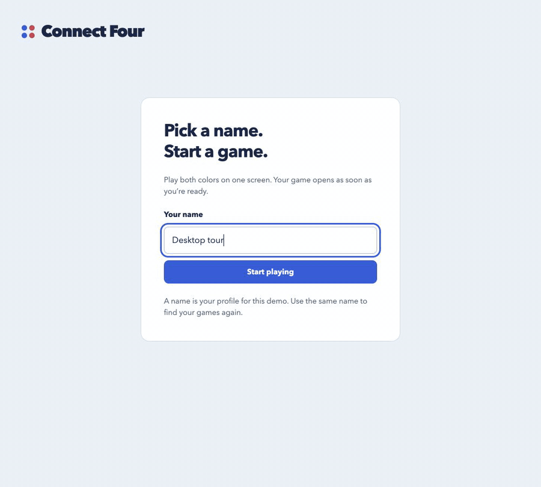
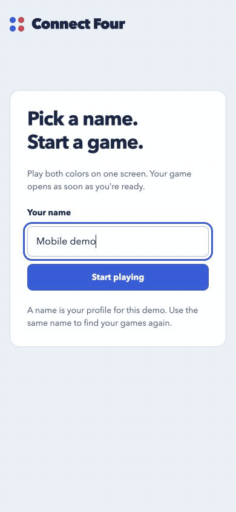

# Connect Four

Pick a name, drop a chip, and come back to the same board.

A persistent, server-authoritative Connect Four game built with React and
FastAPI. Play both colors on one screen, learn as you go, and revisit every
saved game from desktop or mobile.

- **Straight into play.** New profiles start with a fresh board; returning
  profiles resume their last game, including after a browser refresh.
- **Learn by playing.** A short, interactive first-play guide explains gravity,
  alternating turns, and how to win.
- **See every move.** Select a history entry to highlight its chip. Completed
  games stay available to review, with a clear action to play again.
- **Made for both screens.** Desktop navigation and mobile bottom tabs offer
  Play, Games, and Profile. Mobile move history opens in a sheet when needed.
- **Keep your history.** Browse open and finished games, delete games you no
  longer want, and see games played, total moves, draws, and Blue/Red results.
- **The server makes the call.** The backend validates every move, applies
  gravity, and persists the resulting board and history together.

## See it in action

These recordings show the running app with demo profiles and real moves.
The current game supports shared play on one screen; online opponents and chat
are planned improvements.

### Desktop

Start a game, follow the guide, connect four, inspect a move, and browse your
profile and saved games.



### Mobile

The same game with bottom navigation, an on-demand move-history sheet, and
dedicated Games and Profile views.



Both GIFs are stored in [docs/demos](docs/demos/README.md), so the README does
not depend on an external media host.

## Run locally

Use **Python 3.15.2** and **Node.js 24.15+ (24.x) or 26+**. Python is pinned in
the backend's version files; Node 24.15.0 is recorded in the frontend's version
files. The commands below run from the repository root.

Start the backend in one terminal:

```sh
cd backend
uv sync --extra test
uv run uvicorn main:app --port 8080
```

`uv` creates the project-local `.venv` and downloads the pinned Python
interpreter if needed. No global Python or version-manager changes are required.
`uv.lock` records the tested dependency versions.

Start the frontend in another terminal:

```sh
cd frontend
npm install
npm run dev
```

Open [the game](http://localhost:5173). Vite forwards `/api` requests to
the backend on port 8080. Interactive API documentation is available at
[Swagger UI](http://localhost:8080/docs).

If port 8080 is already in use, run the backend on another port and start Vite
with, for example, `API_PROXY_TARGET=http://localhost:8081 npm run dev`.

For Python without uv, see [backend setup](backend/README.md).

## Run tests and checks

Backend, from `backend/`:

```sh
uv run --extra test pytest
uv run --extra test ruff check .
uv run --extra test ruff format --check .
```

Frontend, from `frontend/`:

```sh
npm test
npm run build
```

After activating a Python environment installed with
`python -m pip install -r requirements.txt`, plain `pytest` also works.
Backend tests use temporary databases and never modify saved games.

## How state works

- The database owns every board, turn, result, and accepted move.
- A move submits a **column**, an expected game version, and optionally a player.
  The server chooses the lowest open row. Clients never replace saved boards.
- Each accepted move and board update commit in one transaction. Competing or
  stale requests receive a conflict response instead of overwriting state.
- React Query owns profiles, game lists, and game details. Mutations cache the
  complete server response; the UI does not optimistically place chips.
- A shared fetch client handles cancellation, timeouts, errors, and Zod response
  validation. Move mutations do not retry automatically. An uncertain response
  triggers a fresh read before play can continue.
- Local storage keeps only the active profile ID and last-opened game ID per
  profile. Refreshing reloads actual state from the API.
- Names are trimmed, internal whitespace is collapsed, and matching is
  case-insensitive. Reusing a name resumes the same demo profile. This is not
  authentication or access control.

SQLite data is stored at `backend/data/connect-four.sqlite3` and excluded from
Git. It survives backend restarts. Set `DATABASE_URL` to a different
`sqlite:///...` file URL to use another database.

## API

| Method | Route | Purpose |
|---|---|---|
| POST | `/api/users` | Create or resume a profile by name |
| GET | `/api/users/{user_id}` | Get a profile |
| GET | `/api/users/{user_id}/games` | List its games, newest activity first |
| POST | `/api/games` | Create a game for a user |
| GET | `/api/games/{game_id}` | Get current state and ordered move history |
| POST | `/api/games/{game_id}/moves` | Submit a column and expected version |
| DELETE | `/api/games/{game_id}` | Permanently delete a game and its moves |

There are no reset or round resources. Playing again creates a new game.
The original `POST /evaluate_board_state` remains a stateless compatibility
utility for the exercise's board-evaluation tests. It validates external boards
but cannot create or change saved games; the frontend does not use it.

See [backend documentation](backend/README.md) for request examples, response
fields, errors, and code boundaries.
See [frontend documentation](frontend/README.md) for component structure,
automatic game selection, tutorial behavior, and state-management boundaries.

## What comes next

1. **Online play:** accounts, rooms, and a Blue/Red choice for each player.
2. **Live updates:** WebSockets for moves, presence, and reconnecting to a game.
3. **Chat:** a shared lobby and conversations with your opponent.
4. **Production readiness:** encrypted connections, access controls, further
   anti-cheat checks, migrations, and automated browser checks.
5. **More ways to review:** move replay, refined accessibility, and personal
   rankings once each player owns a side.

See the [ordered improvement plan](NEXT_STEPS.md) for scope and dependencies.

## Stage 2

Replaced client-owned gameplay with a persistent FastAPI/SQLAlchemy API while
retaining the board model and the original evaluation endpoint. Completed the
React UI using Styled Components, React Query, a shared fetch client, and Zod.
Added domain, API, persistence, concurrency, rollback, client-recovery, and UI
tests. Aligned Python settings and documented installation, startup, and tests.
